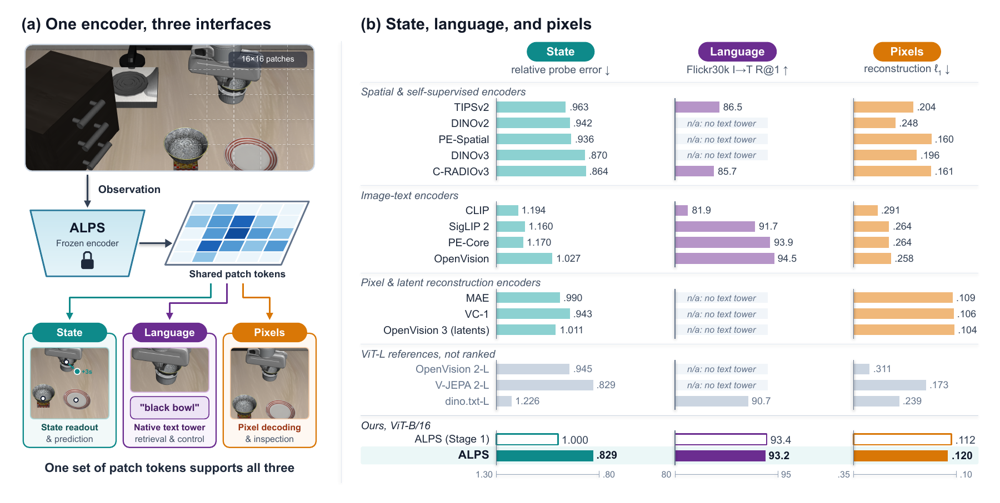
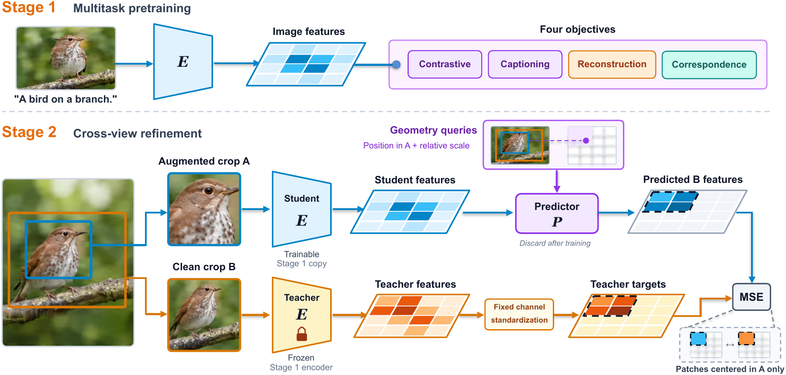
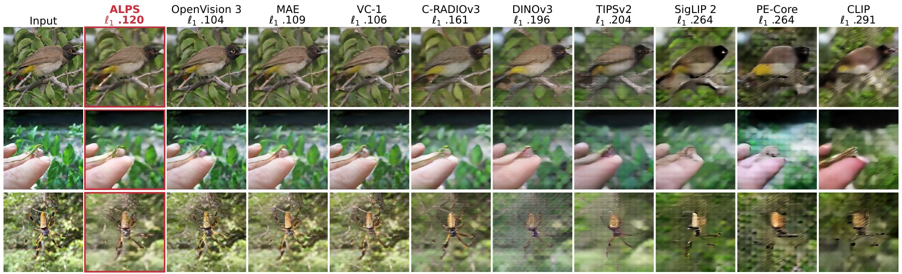
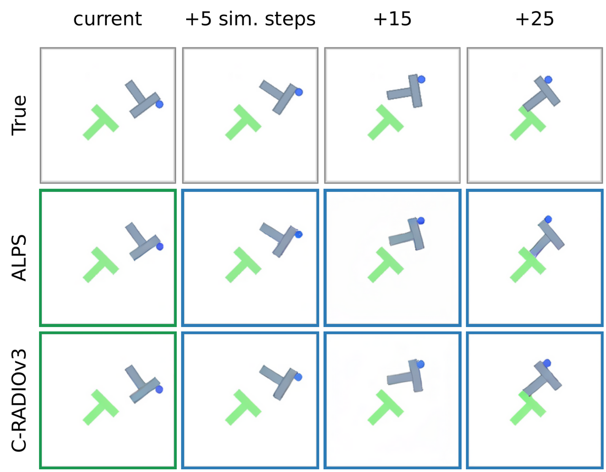

<div align="center">

# 🏔️ ALPS: Visual State Encoders for World Models

**A** **L**anguage-aligned, **P**ixel-renderable **S**tate encoder

[](https://arxiv.org/abs/2610.30120)
[](https://ucsc-vlaa.github.io/ALPS/)
[](https://huggingface.co/UCSC-VLAA/ALPS)
[](LICENSE)



</div>

World models predict and plan in the token space of a frozen visual encoder, so the encoder decides what they can see.
**ALPS** is a ViT-B/16 whose patch tokens give world models and robot policies a state they can **predict**, **instruct**
and **inspect**: the tokens carry physical-state information, align with language through ALPS's own text tower, and
decode back into pixels. Public encoders tend to excel at one of these capabilities; ALPS brings all three into one set of
patch tokens, and no compared encoder is better than ALPS on all three.

## Highlights

- 🎯 **State.** The lowest aggregate LIBERO state-probe error among ViT-B encoders, matching the 3.5x larger V-JEPA 2-L.
- 💬 **Language.** A native text tower: image-text retrieval within 2 points of the best image-text encoders.
- 🖼️ **Pixels.** A lower reconstruction ℓ1 error than every compared encoder not trained to reconstruct pixels or latents.
- 🤖 **Control.** The highest mean policy success on LIBERO: 83.4% with BERT instructions, 85.5% with ALPS's own text tower.
- 🌍 **Planning.** Leads or ties the best world-model planning results on PushT, Wall and Granular, and renders the world
  model's predicted futures as images.
- 📷 **Still images and text only.** Pretrained from scratch without video, actions or an external teacher model.

## Results at a glance

Frozen encoders under one protocol (the encoders of the paper's policy experiments; all fifteen public encoders are in the
figure above and in [`eval/README.md`](eval/README.md)). Best value of each column in bold.

| Encoder | State err. ↓ | IN-1k ↑ | Flickr I→T ↑ | ℓ1 ↓ | LIBERO (BERT) ↑ | LIBERO (own text) ↑ |
|---|:-:|:-:|:-:|:-:|:-:|:-:|
| CLIP-B/16 | 1.194 | 68.4 | 81.9 | .291 | 75.0 | 79.2 |
| SigLIP 2-B/16 | 1.160 | **77.6** | 91.7 | .264 | 81.4 | 84.8 |
| DINOv2-B/14 | .942 | n/a | n/a | .248 | 78.4 | n/a |
| DINOv3-B/16 | .870 | n/a | n/a | .196 | 79.0 | n/a |
| C-RADIOv3-B | .864 | 66.5 | 85.7 | .161 | 78.2 | 81.8 |
| ALPS (Stage 1) | 1.000 | 74.5 | **93.4** | **.112** | 81.1 | - |
| **ALPS** | **.829** | 73.4 | 93.2 | .120 | **83.4** | **85.5** |

State err.: object position error of an attentive probe on the frozen tokens of LIBERO frames (now, 1 s and 3 s ahead;
mean), relative to ALPS (Stage 1). IN-1k: ImageNet-1k zero-shot top-1 (%). Flickr I→T: Flickr30k image-to-text R@1 (%).
ℓ1: reconstruction error of an evaluation decoder on 1,000 held-out ImageNet images. LIBERO: mean policy success (%) over
Long, Goal, Spatial and Object, with LIBERO's BERT instruction embedding or the encoder's own text tower. n/a: no text
tower released; -: not run.

## Quick start

```bash
git clone https://github.com/UCSC-VLAA/ALPS.git && cd ALPS
pip install -e .                 # torch, numpy, pillow
pip install -e ".[test]"         # + safetensors, timm, transformers, pytest
```

```python
import torch, alps
from PIL import Image

model = alps.load("alps-vitb16")                          # downloads alps_vitb16.safetensors from Hugging Face
x = alps.center_crop_transform(Image.open("image.jpg"))   # [1, 3, 224, 224], normalized

with torch.no_grad():
    out = model.encode_image(x)
    z = out["tokens"]            # [1, 196, 768]  raw patch tokens: the visual state
    g = out["pooled"]            # [1, 768]       LayerNorm(mean(z))
    img = model.image_embedding(tokens=z)                      # L2-normalized
    txt = model.text_embedding(["a robot arm opens the top drawer", "a photo of a dog"])
    probs = (model.contrastive_scale() * img @ txt.T).softmax(-1)
```

| Model | File | Description |
|---|---|---|
| `alps-vitb16` | `alps_vitb16.safetensors` | ALPS, the model of the paper (Stage 1 + Stage 2) |
| `alps-stage1-vitb16` | `alps_stage1_vitb16.safetensors` | ALPS (Stage 1), before cross-view refinement |

The weights are published with the paper in the Hugging Face repository
[`UCSC-VLAA/ALPS`](https://huggingface.co/UCSC-VLAA/ALPS), together with the eight ALPS policies of the LIBERO experiments
([`eval/libero_policy`](eval/libero_policy/README.md)). `alps.load` also takes a local file or
`"hf-hub:<org>/<repo>/<file>"`, and `torch.hub.load("UCSC-VLAA/ALPS", "alps_vitb16")` works as well.

<details>
<summary><b>Usage notes</b></summary>

* **Tokens.** The state is the set of raw patch tokens after the last block, without a final LayerNorm, row-major over
  the 14 x 14 grid. World models, policies and probes in the paper read these tokens.
* **Inputs.** RGB in [0, 1], normalized with the ImageNet mean and standard deviation. Natural images: shorter side to
  256, central 224 crop (`alps.center_crop_transform`). Simulator frames: resize the whole frame to 224
  (`alps.resize_transform`). Other resolutions work when the side is a multiple of 16; the position table is then
  interpolated from the 14 x 14 training table.
* **Precision.** Use float32 or bfloat16. float16 overflows in the deeper blocks.
* **Encoder only.** `alps.load_encoder(path)` returns the `VisionTransformer` alone.
* **timm.** `alps.timm_compat.create_timm_model(path)` returns a standard timm `vit_base_patch16_224` with the ALPS
  weights (`forward_features(x)[:, 1:]` are the raw tokens).
* **Zero-shot classification.** `alps.zeroshot.imagenet_classifier(model)` builds the ImageNet classifier of the paper's
  evaluation (OpenAI CLIP class names and 80 templates, as in CLIP_benchmark).
* **Pixels.** `alps.decoder` holds the evaluation decoder (tokens -> SDXL autoencoder latents -> image); train one for
  any encoder with `eval/reconstruction/train_decoder.py`.

</details>

## How ALPS is trained



1. **Stage 1** trains a ViT-B/16 from scratch on image-text pairs with contrastive alignment, captioning, pixel
   reconstruction and cross-view dense correspondence over unnormalized patch tokens (128 px, then 224 px).
2. **Stage 2** refines the encoder on single images by cross-view self-distillation: from an augmented crop, a predictor
   reads the student's tokens and predicts the frozen Stage-1 teacher's standardized tokens at the corresponding locations
   of a clean crop. The language interface of Stage 1 is kept unchanged.

The refinement reduces the Stage-1 state-probe error by 17% while changing image-text retrieval by at most 0.5 points; the
same refinement degrades retrieval by 7 to 12 points on SigLIP 2 and CLIP.

## Pixels from tokens



<p align="center"><i>An evaluation decoder trained on each encoder's frozen tokens (mean ℓ1 on 1,000 held-out ImageNet images).</i></p>

<p align="center"></p>

<p align="center"><i>World-model predictions on PushT, decoded to pixels: true frames (top), and for ALPS and C-RADIOv3 the decoder
outputs from real current tokens (green) and from open-loop predicted tokens given the recorded actions (blue).</i></p>

## What is in this repository

| Folder | Contents |
|---|---|
| [`alps/`](alps) | PyTorch inference package: encoder, text tower, tokenizer, zero-shot helper, evaluation decoder, weight conversion, timm export |
| [`eval/`](eval/README.md) | The unified evaluation of frozen encoders used for every table of the paper, with one interface for ALPS and fifteen public encoders: LIBERO state probe, language, reconstruction, DAVIS / SSv2, LIBERO policies, DINO-WM and LeWorldModel world models |
| [`train_jax/`](train_jax/README.md) | The JAX/Flax code ALPS was trained with (Stage 1 at 128 then 224 pixels, Stage 2), reduced to the paths of the released model |
| [`train_torch/`](train_torch/README.md) | A PyTorch re-implementation of both stages, with parity tests against the JAX code |
| [`tools/`](tools) | Conversion and parity-check scripts |
| [`docs/`](docs) | [Model card](docs/MODEL_CARD.md) and [validation record](docs/VALIDATION.md): the paper's numbers reproduced with this code |

The training data are not released; `train_jax/README.md` describes the record format the input pipelines expect.

## Training and converting checkpoints

`train_jax/` trains both stages on TPUs or GPUs; `train_torch/` does the same in PyTorch (DDP) and writes `alps`
safetensors files directly. Checkpoints of the JAX code convert in three steps (the first two in the JAX environment):

```bash
python tools/export_flax_params.py --ckpt runs/stage1b/checkpoints --out stage1b_params.npz     # language interface
python train_jax/export_encoder.py --ckpt runs/stage2/checkpoints --subtree encoder --out stage2_encoder.npz
python tools/convert_checkpoint.py --stage1 stage1b_params.npz --encoder stage2_encoder.npz --out alps_vitb16.safetensors
```

The converted PyTorch model reproduces the float32 Flax forward of the training code to a relative error below 2e-5 on
the released weights.

## Tests

```bash
pytest                                          # inference package + evaluation code (tests/, eval/), CPU
cd train_jax && pytest tests/                   # JAX training code, in the JAX environment
cd train_torch && pytest tests/                 # PyTorch training code
```

`tests/test_flax_parity.py` compares the PyTorch modules with the Flax modules of the training code; generate its
reference file with `tools/parity/flax_reference.py` in a JAX environment. [`docs/VALIDATION.md`](docs/VALIDATION.md) lists
what was checked before the release.

## Citation

If you use ALPS, please cite the [paper](https://arxiv.org/abs/2610.30120):

```bibtex
@article{liu2026alps,
  title   = {ALPS: Visual State Encoders for World Models},
  author  = {Liu, Yanqing and Zhang, Letian and Liu, Chengzhi and Wang, Zijun and Mei, Jieru and Fei, Hongliang and Zhou, Yuyin and Xie, Cihang},
  journal = {arXiv preprint arXiv:2610.30120},
  year    = {2026}
}
```

## Acknowledgements

We would like to thank the TPU Research Cloud (TRC) program, the Google Cloud Research Credits program, and the Google TPU Builder Award for supporting our computing needs.

ALPS builds on many open-source projects, and we thank their authors and maintainers.

- **Training.** The JAX training code is based on [big_vision](https://github.com/google-research/big_vision) and
  [CLIPA](https://github.com/UCSC-VLAA/CLIPA) and runs on [JAX](https://github.com/jax-ml/jax),
  [Flax](https://github.com/google/flax), [optax](https://github.com/google-deepmind/optax) and
  [Orbax](https://github.com/google/orbax). Stage 1 trains on [DataComp-1B](https://github.com/mlfoundations/datacomp) with
  the captions of [Recap-DataComp-1B](https://huggingface.co/datasets/UCSC-VLAA/Recap-DataComp-1B); Stage 2 uses images of
  the public image-editing datasets listed in the paper. The Stage-2 constant token is an encoding of
  [flan-T5](https://huggingface.co/google/flan-t5-base), and the tokenizer uses the BERT WordPiece vocabulary.
- **World models.** Planning and world-model training follow [DINO-WM](https://github.com/gaoyuezhou/dino_wm), which our
  evaluation patches; the Reacher experiments use [LeWorldModel](https://github.com/lucas-maes/le-wm) and
  [stable-worldmodel](https://github.com/galilai-group/stable-worldmodel).
- **Simulators.** [MuJoCo](https://github.com/google-deepmind/mujoco) (LIBERO, PointMaze, and Reacher through
  [dm_control](https://github.com/google-deepmind/dm_control)), PyFleX as packaged by
  [AdaptiGraph](https://github.com/Boey-li/AdaptiGraph) (Granular, Rope) and [pymunk](https://github.com/viblo/pymunk)
  (PushT).
- **Robot policies.** The policy experiments use [LIBERO](https://github.com/Lifelong-Robot-Learning/LIBERO) (its
  benchmark, demonstrations and BC-Transformer policy), [robomimic](https://github.com/ARISE-Initiative/robomimic) and
  [robosuite](https://github.com/ARISE-Initiative/robosuite).
- **Video.** DAVIS label propagation follows the evaluation of [DINO](https://github.com/facebookresearch/dino) and is
  scored with [davis2017-evaluation](https://github.com/davisvideochallenge/davis2017-evaluation); the SSv2 probe follows
  [V-JEPA 2](https://github.com/facebookresearch/vjepa2).
- **Language and pixels.** Zero-shot prompts come from [CLIP](https://github.com/openai/CLIP) as distributed with
  [CLIP_benchmark](https://github.com/LAION-AI/CLIP_benchmark); the evaluation decoder renders through the
  [SDXL autoencoder](https://huggingface.co/stabilityai/sdxl-vae) and is scored with
  [LPIPS](https://github.com/richzhang/PerceptualSimilarity).
- **Compared encoders.** [DINOv2 and dino.txt](https://github.com/facebookresearch/dinov2),
  [DINOv3](https://github.com/facebookresearch/dinov3), [C-RADIOv3](https://github.com/NVlabs/RADIO),
  [SigLIP 2](https://github.com/google-research/big_vision), [CLIP](https://github.com/openai/CLIP),
  [PE-Core and PE-Spatial](https://github.com/facebookresearch/perception_models),
  [TIPSv2](https://github.com/google-deepmind/tips), [OpenVision 1, 2 and 3](https://github.com/UCSC-VLAA/OpenVision),
  [MAE](https://github.com/facebookresearch/mae), [VC-1](https://github.com/facebookresearch/eai-vc) and
  [V-JEPA 2](https://github.com/facebookresearch/vjepa2), loaded through
  [timm](https://github.com/huggingface/pytorch-image-models), [open_clip](https://github.com/mlfoundations/open_clip),
  [Transformers](https://github.com/huggingface/transformers) and torch.hub.
- **Libraries.** [PyTorch](https://github.com/pytorch/pytorch), [Diffusers](https://github.com/huggingface/diffusers),
  safetensors and TensorFlow.
- **Evaluation data.** ImageNet, COCO, Flickr30k, DAVIS-2017, Something-Something v2, the
  [LIBERO demonstrations](https://huggingface.co/datasets/yifengzhu-hf/LIBERO-datasets) and the datasets of DINO-WM and
  stable-worldmodel.

## License

The code is released under the [Apache License 2.0](LICENSE). Third-party components and their licenses are listed in
[`THIRD_PARTY.md`](THIRD_PARTY.md); the weights of the compared encoders keep their own licenses.
